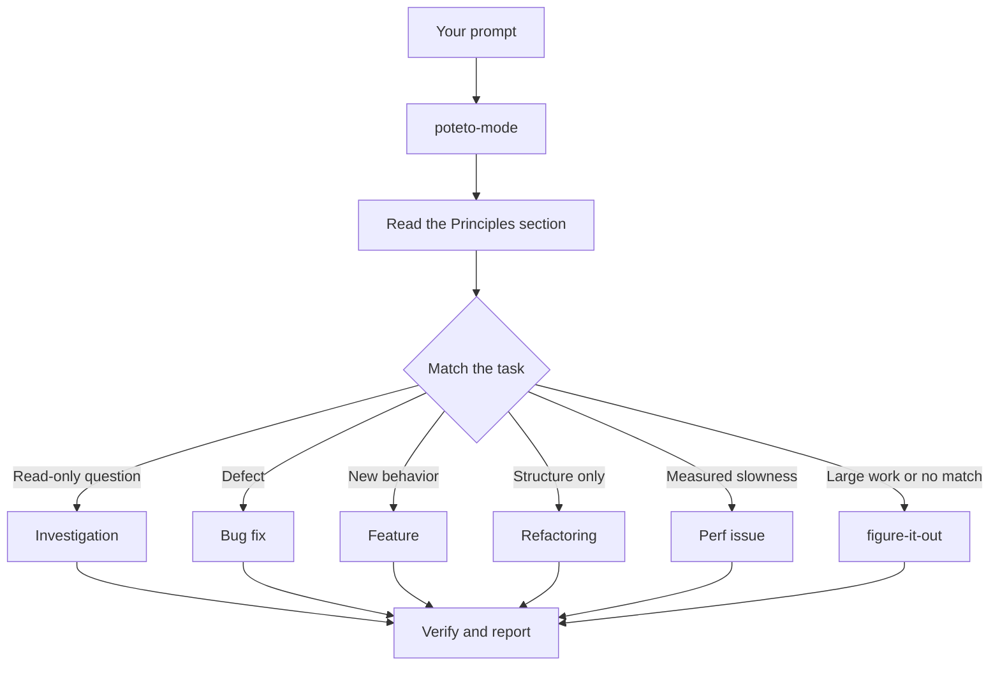

# 通过 `/poteto-mode` 路由工作

`/poteto-mode` 是正门。你给它一个目标，它匹配二十二个剧本（playbook）中的一个，把该剧本的步骤复制进待办清单，并在步骤需要时调用其他技能。本页你会学到一个好提示词长什么样，以及你实际需要写多少。


## 你的提示词会经历什么



图中是常见路径。除此之外还有这些剧本：爬坡优化某个指标、诊断运行时症状和已捕获的 trace、原型、视觉对齐、编写与评估技能、自主运行、开 PR、把 PR 或 PR 栈看护到可合并、交付一个已验证的栈、用自动驾驶跑 PR 队列或栈、接续会话、安全暂停、多阶段计划、以及 worktree 清理。[剧本目录](../../../skills/pstack/poteto-mode/playbooks/)有完整清单。

## 说目标，别说仪式

你不需要写规格说明。你说哪里不对或你想要什么，再加上你已经知道、能帮智能体省时间的任何信息：

```text
/poteto-mode users get two notifications after a retry. repro first, then fix and verify.
```

这是一个 Bug fix 提示词。"repro first" 是真实约束而不是客套话，剧本会遵守它。看着待办清单填上 Bug fix 的步骤。

## 提示词里放什么

一个有用的提示词最多带五样东西，每样一句话就够：

- **目标。** 说哪里不对，或你想要什么。
- **完成判据。** 它必须能通过或失败。"让它更好""花一小时做"都不是判据。
- **你想看到的证据。** 要真实命令输出、流程录像、存储值，或前后对比数字。
- **你已知的信息。** 一个症状、一个复现步骤、一行日志或一个链接，都能省掉智能体一次搜索。
- **真实约束。** "repro first"、"先别改任何代码"、"零行为变化"、"继续前让我过目"，每一条都会改变智能体的行为。

下面是一个五样俱全的提示词：

```text
/poteto-mode the csv export drops its last row since yesterday's deploy. failing job id is 4812. repro first, then fix. done means the 60k-row fixture exports every row. show me the row counts before and after.
```

有两样东西最好别放：

- **怎么做。** 说清要达成什么，给智能体留出找到比你想的更好路径的空间。同样的道理适用于罗列技能，见下面的坑。
- **你对原因的猜测，至少一开始别说。** 一个说出口的猜测会把搜索收窄到你指的方向。让智能体先复述问题，再分享你的直觉。

对于一份噪音很大的报告（比如很长的讨论串或含糊的 bug），把复述设为第一步：

```text
/poteto-mode read this thread. restate the underlying issue in your own words, in plain english. don't change any code yet.
```

误读会在复述阶段暴露，那时还没有任何代码，纠正它只花一条消息，而不是一次错误的修复。只要复述、不走剧本，可以运行 [`/in-your-own-words`](../../../skills/pstack/in-your-own-words/SKILL.md)。它会复述智能体认为你的目标是什么、你在解决什么问题。

拿不准提示词是否瞄准了目标时，发送前先跑 [`/sharpen`](../../../skills/pstack/sharpen/SKILL.md)：

```text
/sharpen write a migration guide for the v2 config format.
```

智能体会说出一位顶尖专家会做、而你没要求的事、他们会从什么原始素材出发、会用什么方法和工具、以及除你和智能体之外还有什么能证明结果是对的。然后它把你的提示词重写成恰好要求这些——更深，但不更大。重写稿会要求智能体用实验能裁决的选择先做原型，并根据观察推荐一个方案，把产品和偏好类选择留给你。它不做任务本身。读一遍重写稿，然后再发送，比如配合 `/poteto-mode`。

当你说不清自己要什么时，先对你自己的描述和文件跑 [`/reframe`](../../../skills/pstack/reframe/SKILL.md)：

```text
/reframe the settings page saves some fields right away and others only on submit, and people lose edits.
```

智能体会给出 8 到 12 个专家术语，按每个术语能改变你构建什么的程度排序。每个术语都附上它命名的描述片段、一个真实使用它的项目（链接已核实），以及它能让你向智能体要求什么。它还会从 2 到 3 个用其他名字解决过同一问题的邻近领域借术语，并说明每个类比在哪里失效。然后用新词重写你的描述。把重写稿发出去，或对它跑 `/sharpen`。

## 追问要短

当对话已经带着上下文时，提示词几乎可以没有内容。下面这些都够：

```text
/poteto-mode do it
```

```text
continue
```

```text
keep going until done
```

短提示词之所以有效，是因为剧本承载了结构，而 pin 住的 `/poteto-mode` 每轮都在上下文里。[安装 pstack](./01-setup.md#run-your-first-task) 讲了怎么 pin。你的话承载意图，技能承载严谨。

## 用 "new task" 切换任务

一个长会话会积累上一个任务的上下文。换话题时要说出来：

```text
/poteto-mode new task. figure out why the cache entry survives logout. don't change any code yet.
```

"new task" 告诉 `/poteto-mode` 重新匹配，而不是继续上一个剧本。"don't change any code yet" 把这个任务钉在 Investigation 上。没有这两个短语，一个进行中的 Feature 模式会把你的问题当成下一个 feature 步骤。

## 让并行工作各占一台机器

如果你在一台电脑上对一个仓库跑多个智能体，它们会在工作树、端口和构建产物上打架。最干净的隔离是云端子代理（profile `spawn.isolation.cloud`）。每个都有自己的环境和分支，可以装依赖、跑你的应用、录制结果视频，而不碰你的机器。让父会话把工作交给云端子代理。当运行环境没有云端选项时，回退方案是单独的本地 git worktree。

工作必须留在本地时，一开始就要 worktree：

```text
/poteto-mode new task. branch off <base> in a fresh worktree, then port the parser change there.
```

每个任务各占分支和 worktree，就不会有智能体踩到别人的文件。worktree 占磁盘和机器资源，所以笔记本一次只能跑几个。[开 PR 剧本](../../../skills/pstack/poteto-mode/playbooks/opening-a-pr.md)对代码改动本来就从 worktree 出发，所以大多数时候你只在基线或位置特别重要时才需要说这句。

worktree 会越积越多。磁盘紧张时问一句：

```text
/poteto-mode what's eating my disk? prune the worktrees that are safe to prune.
```

[Worktree 清理剧本](../../../skills/pstack/poteto-mode/playbooks/worktree-cleanup.md)按合并状态、未提交的改动、以及哪些会话还在用它，把每个 worktree 分类。它只删除证据允许的，并对任何还带着未提交工作的暂停等你决定。

## 让它跑着别管

你离开时，说清什么叫做完，然后走人：

```text
/poteto-mode im stepping away. keep going until the migration check reports zero old callers. log your decisions.
```

事后要你审阅的工作会走 [`/figure-it-out`](../../../skills/pstack/figure-it-out/SKILL.md)，它设计运行的各个阶段并维护一份 [`/show-me-your-work`](../../../skills/pstack/show-me-your-work/SKILL.md) 决策日志。[睡觉时让它跑](./07-overnight.md)讲完整的过夜契约。

**坑：** 不要在提示词里枚举技能（"use /architect, then /arena, then /interrogate..."）。剧本已经排好了顺序，手写序列通常会重排或丢掉剧本本来会保留的步骤。只有当你想覆盖某个特定选择时才点名技能。

完整的路由规则见 [`poteto-mode`](../../../skills/pstack/poteto-mode/SKILL.md) 本身。

下一篇：[理解代码](./03-understand.md)。
