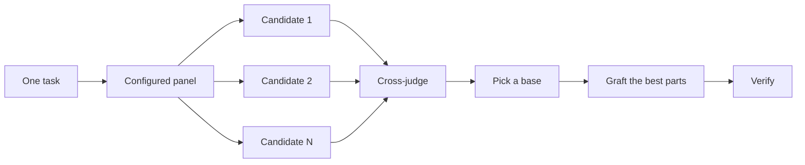

# 写代码之前先设计

对一个难题只试一次，锁定的就是模型最先想到的形状。`/architect` 在实现之前敲定类型和边界。`/arena` 对同一任务书跑多个候选并合并最好的部分。`/interrogate` 让其他模型试着攻破结果。当任务是覆盖面而非设计综合时，`/swarm` 把切片或赛跑分发出去再聚合结果。

最常见的两个设计错误是：直接接受智能体的第一个设计，以及打磨一份还没有任何代码检验过的计划。本页两个都解决。你通过代码来规划：原型回答悬而未决的问题，README 或教程设定目标，书面计划最后才来。


## 用 `/architect` 敲定形状

```text
/architect design the import pipeline before writing any code. i care most about how callers use it.
```

[`/architect`](../../../skills/pstack/architect/SKILL.md) 先追踪变更会碰到的所有系统。然后画出两种不同形状，各带类型、签名和模块边界，并选出那个每块状态只有一个所有者、每件事只有一种做法、调用方需要知道得最少的方案。对于大型或有争议的设计，它会跑 `/arena` 而不是自己画。想在任何代码之前先看到设计，就在提示词里说。

设计在代码开写后并非神圣不可侵犯。如果同一个变通办法反复出现，`/architect` 会重新设计，而不是在周围打补丁。

## 用 `/arena` 分发候选

```text
/arena take my prompt to the arena verbatim. i want to compare their proposals with yours.
```

[`/arena`](../../../skills/pstack/arena/SKILL.md) 是底下的通用工具。N 个子代理并行尝试同一个设计或代码任务书，各自写到自己的 worktree 或目录。一个来自不同模型厂商的只读裁判按评分表给每个候选打分。Fable 和其他 Claude 模型算同一厂商。当没有其他厂商的模型可用时，协调者跳过裁判、自己挑基准候选。协调者端到端读完每个候选，挑一个基准候选，把落选者里最好的想法嫁接进来，再验证结果。



评审团来自你的 [`/setup-pstack`](../../../skills/pstack/setup-pstack/SKILL.md) 配置，也可以按任务调整。决定重要时要更多候选，不重要时要更少：

```text
/arena this, 5 candidates. the cache key format is expensive to change later.
```

## 用 `/swarm` 覆盖切片和赛跑

```text
/swarm check every package under packages/ against its check.sh. one worker per package. one report.
```

[`/swarm`](../../../skills/pstack/swarm/SKILL.md) 把 N 个工作节点分发到相互独立的切片、覆盖矩阵、试炼赛道、探索分区或事先声明的赛跑臂上。每个工作节点拿到自己的范围和检查项，然后汇报 `PASS`、`ISSUES` 或 `BLOCKED`。父会话等齐工作节点，返回一份紧凑报告，附上任何缺口或掉队者。

当并行能换来覆盖面、或让独立检查赛跑时用它。`/arena` 给每个工作节点同一个设计或代码任务书，然后挑基准候选嫁接最好的部分。`/swarm` 覆盖切片，或按事先声明的选择规则跑赛跑。它不走基准候选选择和嫁接那套仪式。

## 用 `/interrogate` 攻破它

```text
/interrogate the whole branch, but skeptically. no nitpicks unless it's an actual bug or regression.
```

[`/interrogate`](../../../skills/pstack/interrogate/SKILL.md) 把变更和它的意图交给配置模型上的对抗者，每个都拿真实代码跑一遍试图攻破。不同对抗者能找到不同的失败。一个发现只有在重跑它的命令确实复现出破坏意图的失败时才存活。报告列出每个已验证发现及发现它的对抗者，然后是每个对抗者丢弃了什么、为什么，并且什么都不应用。

Dropped 列表也要读。你可以推翻结论。

## 用原型代替争论

永远不要接受第一个设计。要几个，然后从看得见的证据里挑：

```text
/poteto-mode prototype a few options for the new dropdown menu. take screenshots or videos for me to compare.
```

[Prototype 剧本](../../../skills/pstack/poteto-mode/playbooks/prototype.md)在一个 scratch 目录里搭一次性草图，把变体放到同一个切换器后面，逐个驱动并截屏或计时。它对行为和算法也适用，不只是 UI。原型是用代码做的规划：它让智能体能跑点东西回答自己的悬而未决问题，而不是来问你，还给你留出你自己想不到的选项。

同样的思路可以放大到真实设计。把 `/architect` 和原型搭配并保留评审闸门：

```text
/poteto-mode we need rate limiting for external webhooks. /architect it first, and answer open questions with prototypes. let me review before proceeding.
```

别把对抗者浪费在抽象计划上。`/interrogate` 会丢掉每一个跑不出来的发现，所以没有代码支撑的计划给它们没什么可攻破的。先用原型解决问题，再评审建成的东西。

## 共享代码先写 README

对于要被其他代码使用的包或 API，从用户会读的那份文档开始：

```text
/poteto-mode write a tutorial for how i would use the new config package first. then /teach me why it beats the current one.
```

先写教程逼你站在调用方视角。你向一个假想用户描述 API，再倒推回实现。这份文档也成了智能体检验自己工作的具体标靶。当文档本身很重要时点名 [`/technical-writing`](../../../skills/pstack/technical-writing/SKILL.md)，免得教程漂移成参考和解释的混合体。

## 设计定了再写计划

pstack 刻意没有规划技能。当你确实想要一份书面计划时，在设计定下来之后再要：

```text
/poteto-mode turn this design into a plan. small verifiable PRs, each with its own verification steps.
```

[Multi-phase plan 剧本](../../../skills/pstack/poteto-mode/playbooks/multi-phase-plan.md)先用原型解决剩余的悬而未决问题，然后每个 PR 写一节，每节以证明变更有效的证据收尾。测试全绿本身不算这种证据。计划就是交付物，剧本不实现它，执行只在你说 go 之后开始。

做迁移时，把标准写进提示词：

```text
/poteto-mode plan the migration of our ui library to the new styling system. small verifiable PRs, each with visual regression checks. the result must match the original exactly, bugs included.
```

"bugs included"防止迁移顺手悄悄修掉东西，那样新旧输出就没法比较了。对于横跨多天的项目，可以把计划提交进仓库一段时间，让其他智能体看到进行中的工作。工作落地后删掉它。

## 一个任务值多少设计功夫？

你可能在想是不是每个变更都需要这些。不需要。大多数变更一样都不需要。一架粗略的梯子：

- 一个小而完整、但你没把握的改动，只需要 `/interrogate`。
- 跨越函数边界或移动所有权的改动，值得 `/architect`；设计大或有争议时它会带上 `/arena`。
- 独立尝试会有帮助的独立决策，比如命名、格式或算法，直接用 `/arena`。
- 覆盖矩阵、一组并行检查、或带声明臂的赛跑，用 `/swarm`。
- 一个跑点东西就能回答的悬而未决问题——布局、时序、方案——用原型，不用争论。
- 一个昂贵到难以回退的有争议设计，先 `/architect`，交付前再 `/interrogate`。
- 跨多个 PR 的工作，在设计定下来后写计划。

`/poteto-mode` 已经应用这架梯子。跨边界的工作会自己触发 `/architect`，所以你直接动用这些，主要是想要比默认更多或更少的审视。

下一篇：[构建并清理变更](./05-build-and-clean.md)。
