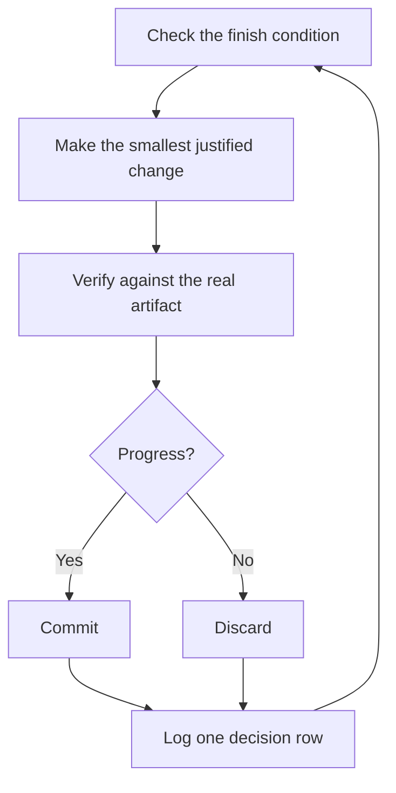

# 睡觉时让它跑

这就是前面所有内容的回报。一个能信任它自我验证的智能体，就是一个你可以放心丢给它难题的智能体。让这件事安全的不是希望，而是可检查的完成条件、隔离的 worktree 或云端智能体，以及一份你早上能审计的决策日志。


## 循环之前先赢得信任

一个你不信任的循环，只会更快地产出没检查过的工作，而且烂摊子每轮复利。让一个循环跑起来之前，先确认它挣到了这个资格：

- 你手动做过这个任务，或看智能体做过，所以你知道好的样子长什么样。
- 智能体拥有你自己会用的工具和信号：验证技能、profiler、日志。
- 每个阶段都证明自己的工作，工作没达标时能拉停线。
- 你读过几份会话记录，把反复出现的失败变成了工具、技能或检查。

四条都成立之后再让循环自主。在那之前，盯着它跑。

## 过夜契约

一次好的交接包含目标、完成条件、权限和逃生舱。不需要很长：

```text
/poteto-mode im going to bed. migrate every caller to the new parser in a fresh worktree off <base>.
done means zero old callers, all parser fixtures pass, old api deleted.
keep a decision log. don't ask me before committing.
loop until done. if you're truly stuck after a few hours, stop and write up why.
```

逐行看它们各自买到什么：

- "im going to bed" 是一次会话级覆盖。智能体停止提问、继续干。
- "done means..." 把目标变成每轮迭代都能跑的检查。
- "fresh worktree off `<base>`" 防止这次运行和你开着的其他东西撞车。
- "don't ask me before committing" 预先回答了智能体否则会卡住的那个权限问题。
- 循环是运行环境的唤醒机制，不是 pstack 技能（profile `loop`）。[Autonomous run 剧本](../../../skills/pstack/poteto-mode/playbooks/autonomous-run.md)用它按事件或心跳重查完成条件。当 profile 写 `loop: unsupported` 时，一次运行每条消息只做一遍、不会自己醒，所以你要重新提示它。
- 逃生舱让它在真正的死胡同时停下并写明原因，这胜过八小时的创造性目标重释。

因为你离开后要审阅这份工作，`/poteto-mode` 会把它路由到 [`/figure-it-out`](../../../skills/pstack/figure-it-out/SKILL.md)，它在任何代码之前设计运行的各阶段并接入决策日志。

要故意停掉一次运行，告诉智能体暂停，或者告诉它你要下线或重启运行环境。[Pause safely 剧本](../../../skills/pstack/poteto-mode/playbooks/pause-safely.md)会完成或回退当前步骤、提交一个进行中的检查点、写一份接续说明。新会话通过 Session pickup 剧本从那份说明接手。说 "keep going" 永远不会触发暂停。

## 循环整夜做什么



每轮迭代：一个改动、一次检查、一行日志。没帮上忙的改动被丢弃，而不是留下来凑数。遇到平台期就转向而不是停下，完成条件也绝不悄悄放松来宣布胜利。

## 早上的审计

[`/show-me-your-work`](../../../skills/pstack/show-me-your-work/SKILL.md) 让这次运行可被审阅。每行记录时间、阶段、决策、理由、证据指针和结果，存在 TSV 里：`decisions.tsv`（多个运行共享目录时用 `.audit/<task-slug>.tsv`）。默认留在本地。工作够大、需要评审者靠痕迹信任结果时，把它提交进仓库。

回来后，要一份评审形式的汇报：

```text
/show-me-your-work catch me up on what you did last night
```

技能交还摘要之前，会派一个不同模型家族的评审者读痕迹和会话记录，回复末尾带一个 Attention 小节，列出值得你细看的地方。先读那一节，再读它指向的日志行。你在审计决策，不是在重读整个夜晚。

想要快速状态而不是审计，在跑过这项工作的会话里运行 [`/ketchup`](../../../skills/pstack/ketchup/SKILL.md)。它只读，用大白话告诉你自上次消息以来变了什么，附上工作产出的截图和小图。然后列出每个等你拍板的决定——合并、批准、选项抉择——各带它的倾向、证据和风险，让你只看回复就能决定。

## 当夜里排的是队列而不是单个任务

上面的契约驱动单个任务奔向单个完成条件。有些夜里装的更多：一队相互独立的改动，或整个项目。两个剧本加一个技能把同样的信任扩展上去。

[Autopilot-full](../../../skills/pstack/poteto-mode/playbooks/autopilot-full.md) 把一队独立 PR 跑到合并。每个 PR 由一个负责智能体（owner）从构建一路带到合并，没有 owner 凭自己的判断合并。一个全新验证者集群检查 owner 的 code-ready 头提交。之后的 rebase 或小修只需一个全新验证者，只有新行为或大 diff 才再次召集完整集群。只有对即将合并的那个补丁的干净结论才授权合并：

```text
/poteto-mode full autopilot on this queue. each item is independent. i want them merged by morning.
```

[Autopilot-stack](../../../skills/pstack/poteto-mode/playbooks/autopilot-stack.md) 是没有合并的 Autopilot-full。你醒来看到的是已验证的 PR，各带结论，由你自己评审并落地。一个 PR 只叠在它构建其上的 PR 上面。当你想在任何东西合并前亲眼过目时选它而不是 Autopilot-full：

```text
/poteto-mode autopilot these five changes, but don't merge. i'll land them in the morning.
```

一个整体工程，比如跨多个包的迁移，没有自己的剧本。`/poteto-mode` 会把大型或跨领域的工作路由到 [`/figure-it-out`](../../../skills/pstack/figure-it-out/SKILL.md)，它为之设计一次严谨的运行：

```text
/poteto-mode migrate every package to the new store. own it until each one is converted and merged. i'll check in twice a day.
```

## 并行跑多个项目

有些运行环境给一个协调者智能体一条持久线程，常叫 project。协调者不写代码，它指挥子代理，子代理可以跑成云端子代理（profile `spawn.isolation.cloud`），所以你的笔记本合上工作也继续。如果你的运行环境没有这种线程，一个长寿命的会话可以当协调者。给协调者的提示词以 `/poteto-mode` 开头，它派生的子代理会跟随剧本。它启动的每个智能体都会先读 [`worker.md`](../../../skills/pstack/poteto-mode/worker.md)，所以工作节点守住启动时的标准、自己拍板可逆的决定而不是来问你、并开出可评审的 PR。

几个有用的习惯：

- 给每项工作自己的协调者线程，比如一个 feature、一次迁移、一轮 perf 冲刺或一次技术债清理。可以并行跑好几个。
- 在运行环境允许时，把相关会话并进协调者线程，做完的也算。它们会成为其中每个智能体的上下文。
- 每个 PR 合并前给一次验证集群，让 Autopilot-stack 或 Autopilot-full 承载队列。
- 让协调者拿出有数据支撑的计划，让它用原型回答悬而未决问题，而不是来问你。

一条提示词可以装下整个工程，从调研到执行：

```text
/poteto-mode refactor this repo so its architecture is more agent friendly. use /correct and /architect on past commits and review comments to find the mistakes agents make most here. use /recall for context from past chats. answer open questions with prototypes instead of asking me. come back with a plan backed by real data. once i approve it, run it with autopilot-stack or autopilot-full, and ask me which.
```

## 让循环自己启动

上面每个循环仍然等你启动。定时或事件驱动的自动化省掉这一步。软件维护很适合拆成这样一条线：分诊报告、复现、修复、验证修复。两条规则让这条线可信：

- 每个阶段都能拉停线。分诊可以判定报告是预期行为，复现可能复现不出来，修复者可以判定改动风险太大。每种结局都有用，因为它阻止坏工作流到下一阶段——在那里撤销的代价更高。
- 每个阶段都交接证据。复现附上破损状态的截图和视频，修复附上前后对比证明。人可以在读一行代码之前先确认智能体修对了东西。

**坑：** 时长不是完成条件。"work on this for 4 hours" 没给智能体任何可检查的东西，你醒来看到的是四小时的动静而不是结果。给循环一个能通过或失败的谓词。

下一篇：[用原则名称引导](./08-principles.md)。
